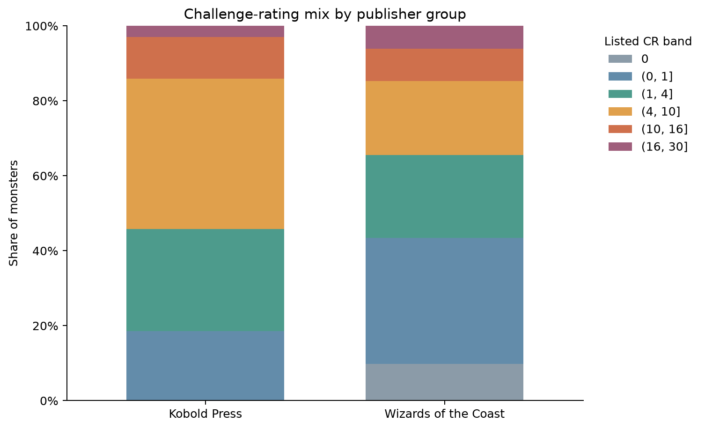
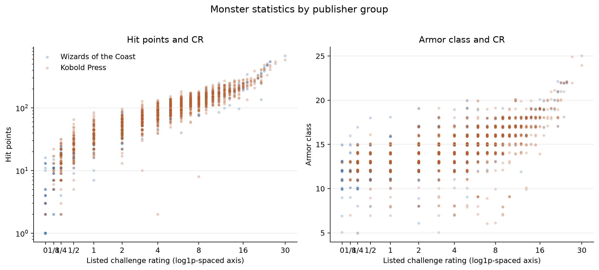
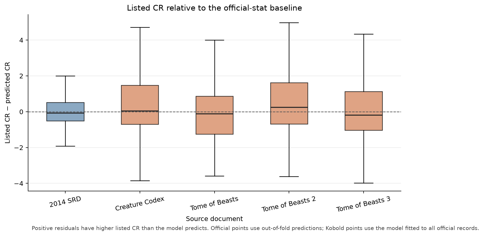

# D&D Challenge Rating Analysis

I wanted to find out whether monsters from third-party D&D books tend to have challenge ratings (CRs) similar to official monsters with comparable basic stats. This project compares four Kobold Press source books with monsters from the 2014 Wizards of the Coast System Reference Document (SRD).

The project combines API acquisition, data checks, exploratory analysis, and a simple statistical baseline. It does **not** test whether CR predicts real combat difficulty or decide whether any monster is misrated.

## Dataset and scope

The Open5e pull used for this analysis was retrieved on **2026-11-06** and contains **1,852 monsters**:

| Source | Records |
| --- | ---: |
| 2014 SRD | 325 |
| Creature Codex | 356 |
| Tome of Beasts | 391 |
| Tome of Beasts 2 | 383 |
| Tome of Beasts 3 | 397 |

The four third-party sources are all from Kobold Press, so the results are about these books—not third-party publishers generally. The records include listed CR, hit points, armor class, six ability scores, source and publisher details, and license metadata.

For this pull, validation found no missing required values or duplicate API keys. The counts describe the records fetched on the date above; a later API pull may differ.

I use the documented Open5e v2 API. It requires no API key. The acquisition script saves timestamped raw JSON pages, follows the API’s pagination links, and writes a CSV and manifest for each selected source. Downloaded data and reports stay local; the repository contains scripts and aggregate figures. Source documents have separate license and attribution terms, so check the terms for each source before reusing or redistributing its content.

Before collecting data, I checked Open5e’s [site robots.txt](https://open5e.com/robots.txt), the [API host robots.txt](https://api.open5e.com/robots.txt), its [legal page](https://open5e.com/legal/), and the [Creature Codex](https://open5e.com/sources/ccdx) and [Tome of Beasts](https://open5e.com/sources/tob) source pages. The robots files have no rule explicitly allowing or disallowing API access; I did not treat that as permission. Requests pause for one second between pages, and raw responses are cached to avoid repeat requests.

## What I found

Median listed CR is 2 for the 2014 SRD and 5 for Kobold Press. Median hit points are 45 and 93, while median armor class is 13 and 15. These differences show that the two collections have different mixes of monsters.



Hit points tend to rise with CR in both collections (Spearman correlations: 0.97 for the SRD and 0.93 for Kobold Press). The CR–AC correlations are 0.69 and 0.70.



For a rough comparison of listed CRs, I fit a linear regression to the 2014 SRD only. It predicts log(1 + CR) from log(1 + hit points), armor class, and six ability scores. Five-fold cross-validation on the official records gave an R-squared of 0.90 on the log-CR scale and a mean absolute error of about 1.15 CR after converting predictions back to the CR scale.

For Kobold Press overall, the median difference between listed CR and the model prediction is about −0.01. This residual is **not** a DMG calculation or a measure of correctness: positive values only mean that listed CR is higher than this model predicts from the included stats. Official records use out-of-fold predictions; third-party records are compared with a model fit to all official records.



## Limits of the comparison

The 2014 Dungeon Master’s Guide’s monster-building procedure estimates defensive CR from effective hit points and AC, and offensive CR from damage per round and attack bonus or save DC, with adjustments for relevant traits ([Dungeon Master’s Guide](https://www.dndbeyond.com/sources/dnd/dmg-2014)). My model does not reproduce that procedure: it uses raw HP, AC, and ability scores, and leaves out damage and special traits. So the residuals describe differences from a simple statistical baseline, not deviations from the official method.

The official rules also define CR relative to an appropriately equipped, well-rested party of four ([2014 Basic Rules](https://www.dndbeyond.com/sources/dnd/basic-rules-2014/monsters)). I don’t have playtest or combat-outcome data, so this project can’t tell whether CR predicts how difficult a fight will feel in actual play. The 2014 SRD is one baseline, and Open5e may not include every monster from either publisher.

I considered estimating damage per round from action descriptions, but the fields are inconsistent. A text-based screen flagged 2,561 attack-like actions; 147 lacked structured attack data. Those are heuristic counts, not verified attacks, and some may not deal damage. I left damage out rather than treat an incomplete parser as reliable.

## Reproduce the project

Use Python 3.10 or newer. Create and activate a virtual environment, install dependencies, then run the commands below from the repository root. The scripts require no API key.

```bash
python -m venv .venv
```

Activate it in PowerShell:

```powershell
.venv\Scripts\Activate.ps1
```

Or on macOS/Linux:

```bash
source .venv/bin/activate
```

Then install dependencies:

```bash
python -m pip install -r requirements.txt
```

From the repository root, acquire the five sources, validate them, review attack-field coverage, and generate the analysis:

```bash
python scripts/acquire_open5e.py \
  --document-key srd-2014 --document-key ccdx \
  --document-key tob --document-key tob2 --document-key tob3

python scripts/validate_data.py \
  data/processed/creatures_srd-2014.csv \
  data/processed/creatures_ccdx.csv \
  data/processed/creatures_tob.csv \
  data/processed/creatures_tob2.csv \
  data/processed/creatures_tob3.csv \
  --report data/processed/validation.json

python scripts/inspect_attack_coverage.py \
  --raw-dir data/raw/open5e \
  --document-key srd-2014 --document-key ccdx \
  --document-key tob --document-key tob2 --document-key tob3 \
  --report data/processed/attack_coverage.json

python scripts/analyze_monsters.py \
  data/processed/creatures_srd-2014.csv \
  data/processed/creatures_ccdx.csv \
  data/processed/creatures_tob.csv \
  data/processed/creatures_tob2.csv \
  data/processed/creatures_tob3.csv
```

The acquisition script defaults to 100 records per page and a one-second delay between pages. `--max-pages` makes a partial feasibility pull; partial files are labeled so they aren’t confused with complete pulls. Open5e can change over time, so later pulls may have different counts; manifests record the retrieval time and API totals.

The validator reports coverage, missingness, numeric summaries, duplicates, license metadata, and whether each manifest records a complete pull. It flags issues but does not silently delete records. The attack-coverage script reviews cached pages; it does not estimate damage per round. The analysis writes figures to `figures/` and an EDA summary plus residual-review table to `data/processed/`.

## Repository contents

- `scripts/acquire_open5e.py` — paginated API acquisition and CSV creation
- `scripts/validate_data.py` — completeness and data-quality report
- `scripts/inspect_attack_coverage.py` — diagnostic screen of attack-related fields
- `scripts/analyze_monsters.py` — EDA summaries, model comparison, and figures
- `figures/` — aggregate figures generated by the analysis
- `data/raw/` and `data/processed/` — local acquisition files and reports; ignored by Git

## References

- [Open5e API documentation](https://open5e.com/api-docs)
- [Open5e source documents](https://open5e.com/sources)
- [Open5e legal page](https://open5e.com/legal/)
